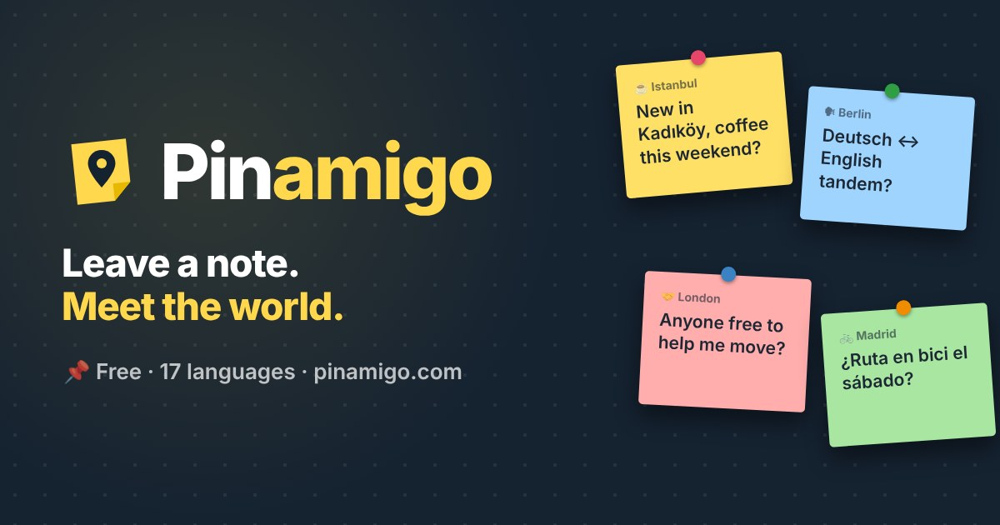

  

  <a href="https://pinamigo.com"><b>🌍 pinamigo.com</b></a> ·
  <a href="https://instagram.com/pinamigo">Instagram</a> ·
  <a href="https://github.com/huseyinaguclu/pinamigo-app/discussions">Discussions</a>

<b>Free · 17 languages · Web + mobile (PWA)</b>

---

## What is Pinamigo?

Stick a short note on the world map — *"New in Kadıköy, looking for friends to explore the city with 🗺️"* — and someone who sees it writes to you. Add a song from YouTube or Spotify and people can listen to it right on your note. 🎵

Find friends, activity partners, a language exchange buddy, or a job. **No swiping, no endless profiles — the note comes first.**

## How it works

| | |
|---|---|
| 📌 **Leave a note** | Write what you're looking for, pick a category, pin it to the exact spot on the map. |
| 🎵 **Add a song** | Paste a YouTube or Spotify link. Your note shows the cover and title; anyone can tap ▶ Listen to play it. |
| 🔎 **Explore cities** | Tap a city to see all its notes. Roll the dice for a surprise note from anywhere in the world. |
| 💬 **Write** | Message the note's owner. Different language? Translate with one tap. |

## Categories

🤝 Friendship · 🚴 Activities · 🗣️ Language exchange · 🎉 Events · 🤲 Helping out · 💼 Jobs · 💬 Someone to talk to · 🤫 Confessions · 🍃 Just because · 🌐 Remote · ✈️ Travel notes

## Privacy first

- 🔒 **End-to-end encrypted messages** — nobody can read them, admins included.
- ⏳ **Chats disappear after 24 hours** — the timer starts with the first reply, then the whole chat is permanently deleted.
- 📍 **Where you are is never shown** — your note appears at the spot you mark, and your device location is only used to check that the spot is within 20 km. Pick a public place, not your home.
- 🔑 **No passwords** — sign in with a 6-digit code sent to your email. Your email is never shown to other users.
- 🔞 18+ only.

## Try it

👉 **[pinamigo.com](https://pinamigo.com)** — works in any browser. On your phone, tap *"Add to Home Screen"* to use it like an app.

## Feedback

Ideas, bug reports and suggestions are very welcome — start a thread in **[Discussions](https://github.com/huseyinaguclu/pinamigo-app/discussions)** or open an **[Issue](https://github.com/huseyinaguclu/pinamigo-app/issues)**.

This repository is Pinamigo's public home for announcements and feedback. The app's source code is not included.
